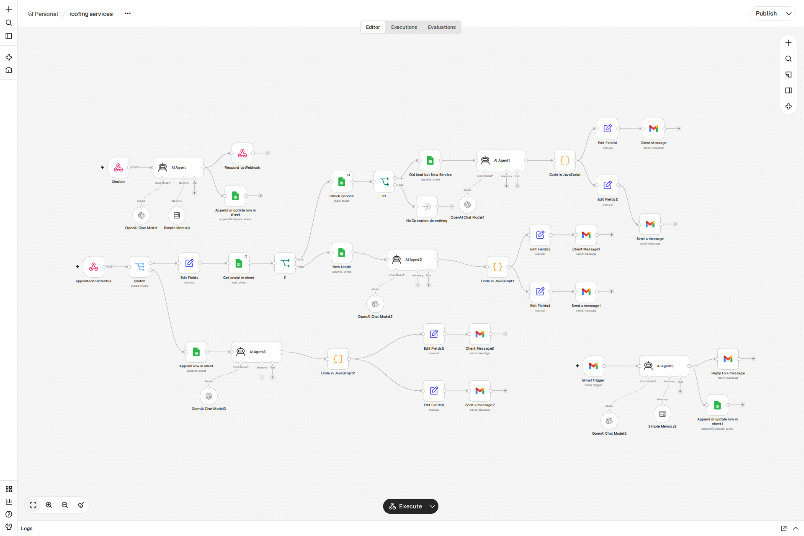

# Roofing Lead Response & Lightweight CRM

Lead intake and follow-up workflow using webhooks, AI-assisted response generation, Gmail and Google Sheets.

## Overview

## Included capabilities

- Website lead/contact intake through webhooks
- Lead lookup and Google Sheets tracking
- AI-assisted customer response drafting
- Gmail follow-up branches and inbound email trigger node

## Setup

1. Review this README and the exported JSON before importing.
2. Import the JSON into a compatible n8n instance.
3. Replace all `YOUR_*` placeholders and reconnect credentials in your own environment.
4. Confirm provider node versions, API permissions, data schema, webhook URLs and timezone.
5. Keep the workflow inactive until the validation tests pass.

## Limitations and production checklist

- Configure webhook authentication, rate limiting and request validation before public exposure.
- Validate Gmail Trigger filters and thread-level duplicate suppression.
- This export has not been live-tested against the connected business accounts.

## Suggested validation tests

- [ ] Valid and invalid webhook payload
- [ ] Repeated delivery does not create duplicate leads
- [ ] Gmail subject/body fields are populated
- [ ] Inbound reply stops future follow-up
- [ ] Sheets failure does not silently drop a lead

## Security

- Never commit API keys, OAuth tokens, private webhook URLs, phone numbers or customer data.
- Use least-privilege credentials and provider-side rate limits.
- Configure authentication and request validation on public webhooks.
- Test with synthetic records before connecting live customers.

## Verification status

This repository update includes static JSON/configuration and documentation cleanup. It does **not** mean the workflow has been executed end-to-end. Mark a test as passed only after observing the actual execution in your own connected environment.

## Files

- `roofing-lead-response-crm.json` — workflow/configuration export
- `screenshot.png` — existing workflow overview
