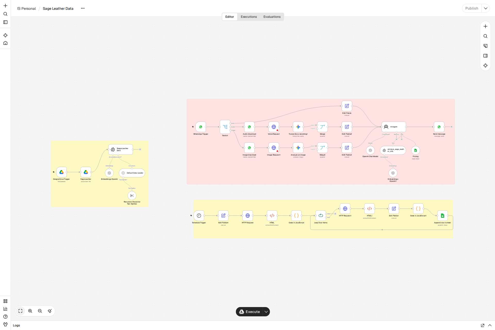

# WhatsApp Product Support & Knowledge Assistant

WhatsApp support workflow accepting text, voice and product images, with Pinecone knowledge retrieval and Google Sheets pricing lookup.

## Overview

## Included capabilities

- Text, audio and image message routing
- Gemini voice transcription and image analysis
- AI Agent with OpenAI chat model
- Pinecone knowledge retrieval and Google Sheets pricing tool
- Scheduled product-sitemap ingestion branch

## Setup

1. Review this README and the exported JSON before importing.
2. Import the JSON into a compatible n8n instance.
3. Replace all `YOUR_*` placeholders and reconnect credentials in your own environment.
4. Confirm provider node versions, API permissions, data schema, webhook URLs and timezone.
5. Keep the workflow inactive until the validation tests pass.

## Limitations and production checklist

- Configure WhatsApp, Drive, Sheets, OpenAI, Gemini and Pinecone credentials and IDs after import.
- Drive trigger watches file updates; validate new-file ingestion and stale-vector replacement before relying on KB refresh.
- Sitemap parsing uses generic metadata and may need store-specific selectors.
- Customer conversations are not logged to Google Sheets in this export.

## Suggested validation tests

- [ ] Text question uses approved KB data
- [ ] Voice note reaches agent as plain text
- [ ] Image analysis returns usable text
- [ ] Unknown question does not hallucinate
- [ ] Reply goes to inbound sender
- [ ] Sitemap handles missing metadata and duplicate URLs

## Security

- Never commit API keys, OAuth tokens, private webhook URLs, phone numbers or customer data.
- Use least-privilege credentials and provider-side rate limits.
- Configure authentication and request validation on public webhooks.
- Test with synthetic records before connecting live customers.

## Verification status

This repository update includes static JSON/configuration and documentation cleanup. It does **not** mean the workflow has been executed end-to-end. Mark a test as passed only after observing the actual execution in your own connected environment.

## Files

- `whatsapp-rag-agent-sage-leather.json` — workflow/configuration export
- `screenshot.png` — existing workflow overview
