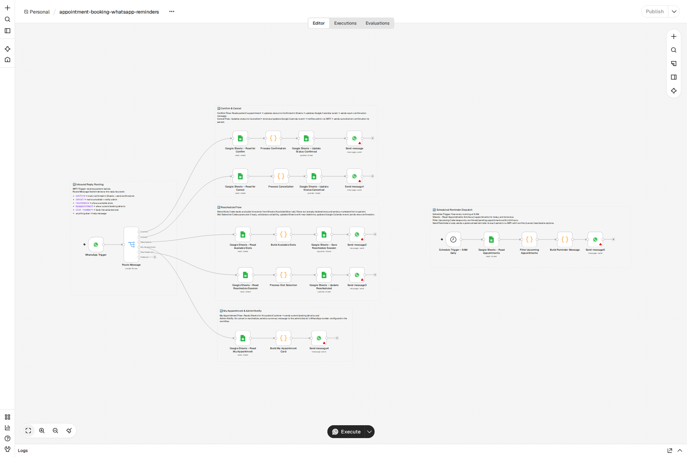

# Clinic Appointment Reminders & Self-Service

WhatsApp appointment reminder and patient-reply prototype built with n8n and Google Sheets.

## Overview

## Included capabilities

- Scheduled reminder dispatch
- Inbound WhatsApp keyword routing for confirm, cancel, reschedule and appointment lookup
- Google Sheets-based appointment/session data

## Setup

1. Review this README and the exported JSON before importing.
2. Import the JSON into a compatible n8n instance.
3. Replace all `YOUR_*` placeholders and reconnect credentials in your own environment.
4. Confirm provider node versions, API permissions, data schema, webhook URLs and timezone.
5. Keep the workflow inactive until the validation tests pass.

## Limitations and production checklist

- The export has no verifiable Google Calendar nodes; calendar-sync claims have been removed.
- Slot selection needs concurrency/atomic availability protection before clinic use.
- Validate the actual WhatsApp provider payload and credentials before enabling.

## Suggested validation tests

- [ ] Reminder window and timezone
- [ ] Confirm changes only the matching patient's appointment
- [ ] Cancel affects only the matching patient appointment
- [ ] Stale or booked reschedule slot is rejected
- [ ] Unknown command returns a safe help response

## Security

- Never commit API keys, OAuth tokens, private webhook URLs, phone numbers or customer data.
- Use least-privilege credentials and provider-side rate limits.
- Configure authentication and request validation on public webhooks.
- Test with synthetic records before connecting live customers.

## Verification status

This repository update includes static JSON/configuration and documentation cleanup. It does **not** mean the workflow has been executed end-to-end. Mark a test as passed only after observing the actual execution in your own connected environment.

## Files

- `appointment-booking-whatsapp-reminders.json` — workflow/configuration export
- `screenshot.png` — existing workflow overview
