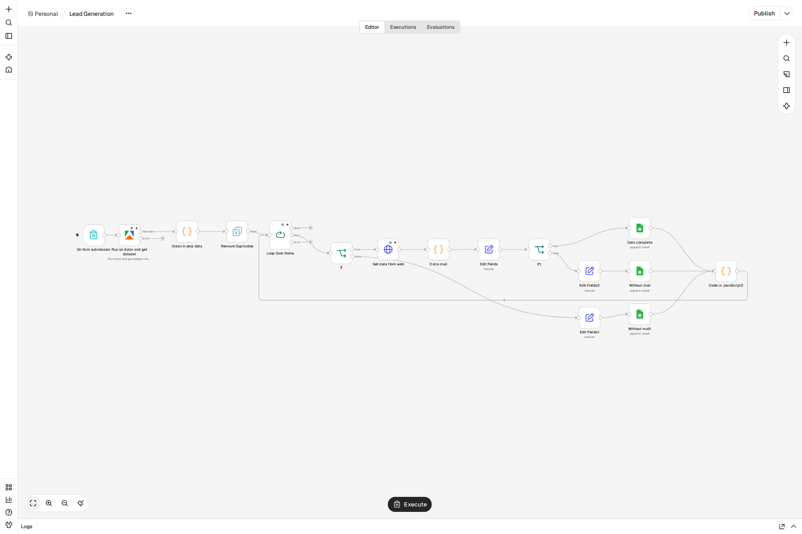

# Lead Scraping & Enrichment Pipeline

Lead intake and enrichment using an external scraping provider and spreadsheet output.

## Overview

## Included capabilities

- Lead request intake
- External scraping/enrichment provider integration
- Email extraction and normalization
- Spreadsheet-ready output

## Setup

1. Review this README and the exported JSON before importing.
2. Import the JSON into a compatible n8n instance.
3. Replace all `YOUR_*` placeholders and reconnect credentials in your own environment.
4. Confirm provider node versions, API permissions, data schema, webhook URLs and timezone.
5. Keep the workflow inactive until the validation tests pass.

## Limitations and production checklist

- Email syntax validation does not prove deliverability.
- Provider settings and API access must match the provider's current schema.
- Limit personal-data scraping to lawful, necessary business-contact data.
- Clearing deduplication history is not the same as deduplicating the current batch; verify node operation before production.

## Suggested validation tests

- [ ] Empty and malformed input
- [ ] Duplicate leads in one batch
- [ ] Missing/invalid email
- [ ] Provider timeout and rate limit
- [ ] TLS certificate verification remains enabled

## Security

- Never commit API keys, OAuth tokens, private webhook URLs, phone numbers or customer data.
- Use least-privilege credentials and provider-side rate limits.
- Configure authentication and request validation on public webhooks.
- Test with synthetic records before connecting live customers.

## Verification status

This repository update includes static JSON/configuration and documentation cleanup. It does **not** mean the workflow has been executed end-to-end. Mark a test as passed only after observing the actual execution in your own connected environment.

## Files

- `lead-scraper-enrichment.json` — workflow/configuration export
- `screenshot.png` — existing workflow overview
