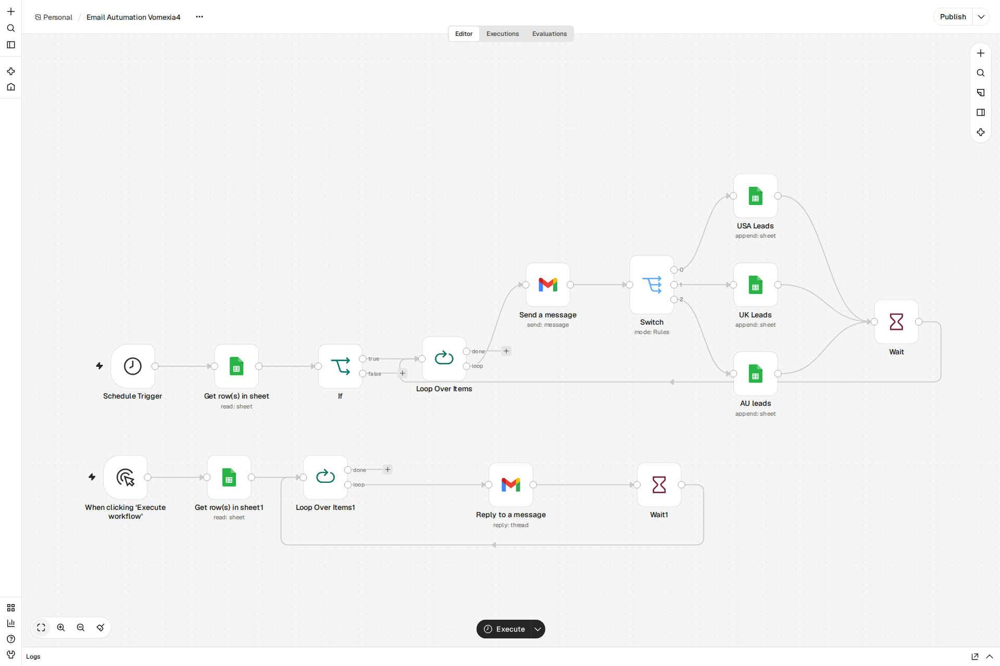

# Scheduled Email Follow-up Sequence

A scheduled, spreadsheet-driven email sequence with waits and branching for controlled follow-up campaigns.

## Overview

## Included capabilities

- Scheduled lead retrieval from Google Sheets
- Region-based lead grouping and follow-up scheduling
- Gmail sending and wait/branch logic
- Spreadsheet logging of sent-message metadata

## Setup

1. Review this README and the exported JSON before importing.
2. Import the JSON into a compatible n8n instance.
3. Replace all `YOUR_*` placeholders and reconnect credentials in your own environment.
4. Confirm provider node versions, API permissions, data schema, webhook URLs and timezone.
5. Keep the workflow inactive until the validation tests pass.

## Limitations and production checklist

- The export does not include a dedicated inbound Gmail Trigger for reply detection; reply-handling claims have been removed.
- A send action is not reply detection. Add inbound trigger/polling and thread-level suppression before live use.
- Use consent-compliant lists, unsubscribe/suppression handling and sending limits.

## Suggested validation tests

- [ ] Use an internal test mailbox
- [ ] Verify at-most-once sending per sequence step
- [ ] Verify wait timing and stop conditions
- [ ] Confirm replies are not claimed as detected without an inbound trigger

## Security

- Never commit API keys, OAuth tokens, private webhook URLs, phone numbers or customer data.
- Use least-privilege credentials and provider-side rate limits.
- Configure authentication and request validation on public webhooks.
- Test with synthetic records before connecting live customers.

## Verification status

This repository update includes static JSON/configuration and documentation cleanup. It does **not** mean the workflow has been executed end-to-end. Mark a test as passed only after observing the actual execution in your own connected environment.

## Files

- `email-followup-automation.json` — workflow/configuration export
- `screenshot.png` — existing workflow overview
