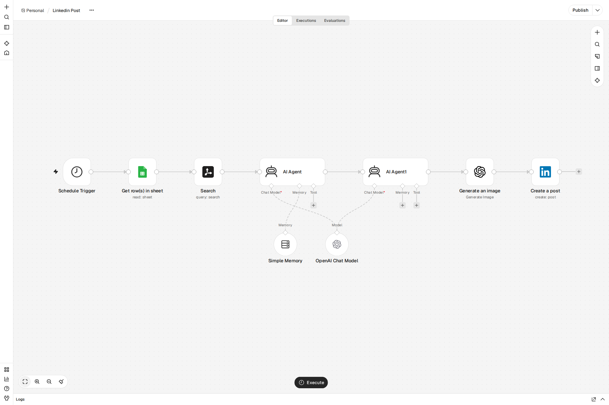

# LinkedIn Content Preparation Workflow

A content workflow prototype that prepares a topic-led post and image asset before a LinkedIn publishing step.

## Overview

## Included capabilities

- Scheduled/manual content entry
- AI-assisted post drafting
- Image-generation step
- LinkedIn publishing integration

## Setup

1. Review this README and the exported JSON before importing.
2. Import the JSON into a compatible n8n instance.
3. Replace all `YOUR_*` placeholders and reconnect credentials in your own environment.
4. Confirm provider node versions, API permissions, data schema, webhook URLs and timezone.
5. Keep the workflow inactive until the validation tests pass.

## Limitations and production checklist

- Review generated copy and image before publishing; use a human approval gate before unattended posting.
- LinkedIn API permissions and image-upload requirements depend on the connected app/account.
- Validate memory and output mappings in the target n8n version.

## Suggested validation tests

- [ ] Draft output is non-empty
- [ ] Image output is usable
- [ ] Approval prevents unintended publication
- [ ] Post includes both text and image when configured

## Security

- Never commit API keys, OAuth tokens, private webhook URLs, phone numbers or customer data.
- Use least-privilege credentials and provider-side rate limits.
- Configure authentication and request validation on public webhooks.
- Test with synthetic records before connecting live customers.

## Verification status

This repository update includes static JSON/configuration and documentation cleanup. It does **not** mean the workflow has been executed end-to-end. Mark a test as passed only after observing the actual execution in your own connected environment.

## Files

- `linkedin-auto-poster.json` — workflow/configuration export
- `screenshot.png` — existing workflow overview
