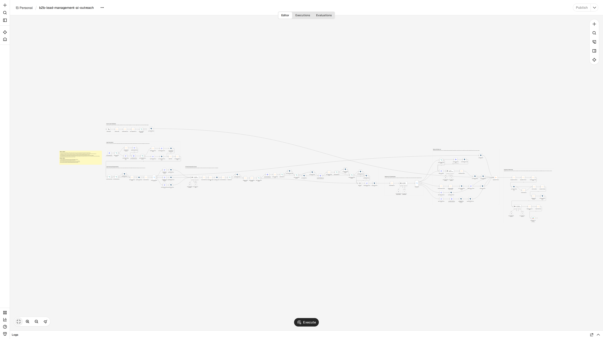

# B2B Lead Management & Outreach Prototype

An SDR-pipeline demonstration covering lead validation, enrichment, scoring, email drafting/sending and event logging.

## Overview

## Included capabilities

- Lead intake and validation branches
- AI-assisted qualification/scoring and email drafting
- PostgreSQL event-log pattern
- Simulated external enrichment and social-channel touchpoints

## Setup

1. Review this README and the exported JSON before importing.
2. Import the JSON into a compatible n8n instance.
3. Replace all `YOUR_*` placeholders and reconnect credentials in your own environment.
4. Confirm provider node versions, API permissions, data schema, webhook URLs and timezone.
5. Keep the workflow inactive until the validation tests pass.

## Limitations and production checklist

- Contains synthetic example leads and JSONPlaceholder test endpoints.
- LinkedIn/WhatsApp/SMS steps are simulations, not authenticated production send integrations.
- No verified inbound reply trigger is present in this export.
- Do not use real contact data or enable outbound sending until consent, suppression and provider controls exist.

## Suggested validation tests

- [ ] Run only with synthetic records
- [ ] Ensure test emails cannot reach real recipients
- [ ] Verify database schema and event uniqueness
- [ ] Keep simulated channel steps clearly labelled

## Security

- Never commit API keys, OAuth tokens, private webhook URLs, phone numbers or customer data.
- Use least-privilege credentials and provider-side rate limits.
- Configure authentication and request validation on public webhooks.
- Test with synthetic records before connecting live customers.

## Verification status

This repository update includes static JSON/configuration and documentation cleanup. It does **not** mean the workflow has been executed end-to-end. Mark a test as passed only after observing the actual execution in your own connected environment.

## Files

- `b2b-lead-management-ai-outreach.json` — workflow/configuration export
- `screenshot.png` — existing workflow overview
