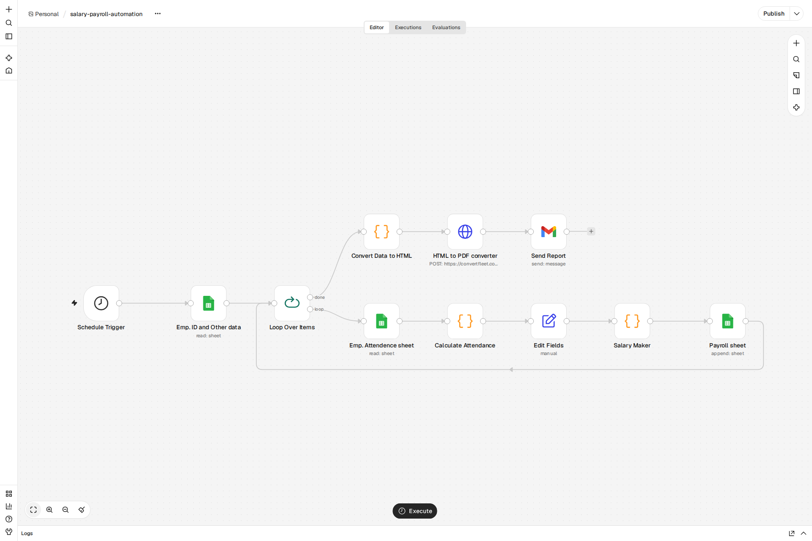

# Attendance & Payroll Calculation Workflow

Attendance aggregation and payroll reporting prototype using Google Sheets, n8n code, PDF conversion and Gmail.

## Overview

## Included capabilities

- Attendance aggregation by employee
- Present/absent/leave/holiday/half-day counts
- Working-time calculation
- PDF report generation and manager email

## Setup

1. Review this README and the exported JSON before importing.
2. Import the JSON into a compatible n8n instance.
3. Replace all `YOUR_*` placeholders and reconnect credentials in your own environment.
4. Confirm provider node versions, API permissions, data schema, webhook URLs and timezone.
5. Keep the workflow inactive until the validation tests pass.

## Limitations and production checklist

- Payroll rules vary by employer and jurisdiction; this is an illustrative calculator, not payroll/legal advice.
- The export contains a fixed historical test period; configure period and pay rules before running.
- Appending payroll rows can duplicate results on rerun; add a unique employee-period key and upsert protection.
- Review the external PDF service's privacy terms before sending employee data.

## Suggested validation tests

- [ ] Period boundary dates
- [ ] Missing/invalid attendance time
- [ ] Overnight shifts
- [ ] Half-day and unpaid-leave policy
- [ ] Rerun does not duplicate payroll rows
- [ ] PDF attachment is correct

## Security

- Never commit API keys, OAuth tokens, private webhook URLs, phone numbers or customer data.
- Use least-privilege credentials and provider-side rate limits.
- Configure authentication and request validation on public webhooks.
- Test with synthetic records before connecting live customers.

## Verification status

This repository update includes static JSON/configuration and documentation cleanup. It does **not** mean the workflow has been executed end-to-end. Mark a test as passed only after observing the actual execution in your own connected environment.

## Files

- `salary-payroll-automation.json` — workflow/configuration export
- `screenshot.png` — existing workflow overview
