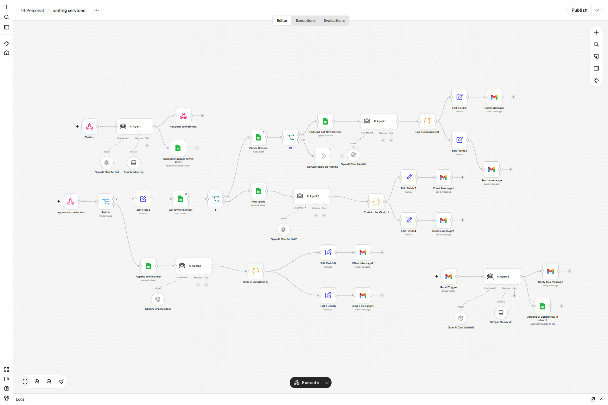

# Roofing Lead Response CRM

End-to-end lead intake and response system for a local service business, built in n8n.

## Workflow

## What it does

Captures leads from a website chatbot and a contact/appointment form, checks whether the contact is a new lead, an old lead requesting a new service, or an existing customer, then routes each case through the right AI-driven response.

## How it works

- Two webhooks receive events: one from a website chatbot widget, one from an appointment/contact form
- A `Switch` node routes the payload based on source and intent
- An AI Agent (GPT-4o via OpenAI, with conversation memory) reads the incoming message and the lead's history in Google Sheets to decide how to respond
- New leads get logged to a "New Leads" sheet; returning leads requesting a different service get logged separately ("Old lead but New Service") so nothing is missed
- A second AI Agent drafts and sends a personalized email reply via Gmail, and a third layer handles inbound Gmail replies (Gmail Trigger) so the conversation continues automatically
- All lead data — status, service requested, timestamps — is written back to Google Sheets, functioning as a lightweight CRM

## Why it matters

Service businesses lose leads when nobody responds fast enough. This closes that gap — lead comes in, gets qualified and answered within seconds, and is tracked without a human touching a spreadsheet.

## File

- `roofing-lead-response-crm.json` — n8n workflow, 44 nodes

## Requirements

- n8n instance
- OpenAI API key (GPT-4o)
- Google Sheets (New Leads sheet + Old lead but New Service sheet)
- Gmail account
- Website chatbot widget + appointment/contact form posting to the webhooks

## Setup

1. Import `roofing-lead-response-crm.json` into n8n (`Workflows → Import from File`)
2. Replace placeholder values (`YOUR_GOOGLE_SHEET_ID_*`, `YOUR_CREDENTIAL_ID`, webhook URLs) with your own credentials and sheet IDs
3. Set up the Google Sheets with matching column headers
4. Point your chatbot widget and contact form at the two webhook URLs

## Note

Sanitized for public sharing — credentials, sheet IDs, client contact numbers, and webhook URLs have been replaced with placeholders.
