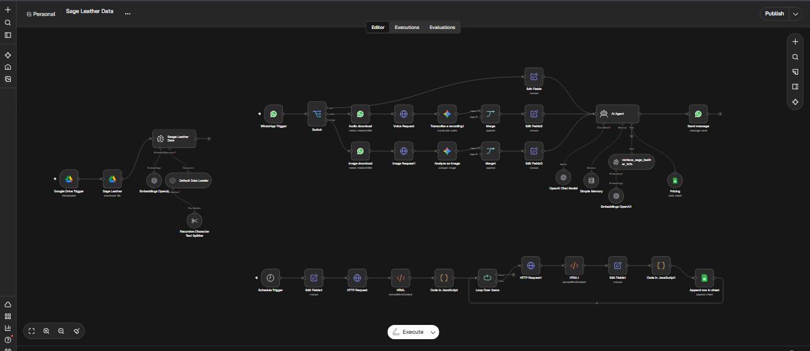

# Sage Leather WhatsApp Support & Product Knowledge Workflow

A multi-input WhatsApp support workflow that routes text, voice notes, and product images to a support agent. The agent can use a Pinecone knowledge base for company/product information and a Google Sheet for product pricing.

## Workflow overview

## Capabilities

- Receives WhatsApp messages and routes text, audio, and image inputs
- Transcribes voice notes with Google Gemini
- Analyzes product images with Google Gemini
- Uses an n8n AI Agent with an OpenAI chat model
- Retrieves company/product knowledge from a Pinecone index
- Looks up product pricing from a Google Sheet
- Sends the reply to the original WhatsApp sender
- Includes a separate scheduled product-sitemap ingestion branch that extracts product metadata and appends rows to a Google Sheet

## Important implementation notes

- The audio and image branches convert Gemini output to a plain-text field before it reaches the AI Agent.
- The WhatsApp recipient is read from the inbound trigger payload; there is no fixed test phone number.
- WhatsApp media requests use the WhatsApp credential selected in n8n. No bearer token is embedded in this exported workflow.
- The sitemap URL, WhatsApp phone-number ID, Google Sheet ID, Drive folder, Pinecone index, and credentials are setup values and must be configured for the target business.
- The Drive trigger is configured for file updates. Confirm the trigger event and file types supported by your n8n version before relying on automatic knowledge refresh.
- The sitemap extraction uses generic product-page metadata and may need selectors adjusted for the target store platform. The scheduled branch is not a universal ecommerce scraper.
- This workflow does not currently log customer conversations to Google Sheets.

## Requirements

- n8n with the WhatsApp, Google Drive, Google Sheets, OpenAI, Gemini, and LangChain/Pinecone nodes available
- WhatsApp Business Cloud API credentials and a configured WhatsApp Trigger
- OpenAI credentials for chat and embeddings
- Google Gemini credentials
- Pinecone index compatible with the selected embedding model
- Google Drive folder containing source knowledge PDFs
- Google Sheet with product columns matching the pricing lookup and ingestion mappings
- A public product sitemap URL if using the scheduled ingestion branch

## Setup

1. Import `whatsapp-rag-agent-sage-leather.json` into n8n.
2. Re-select/create credentials for WhatsApp Trigger, WhatsApp, Google Drive, Google Sheets, OpenAI, Gemini, and Pinecone. Imported credential IDs are placeholders.
3. Set the WhatsApp Phone Number ID on the **Send message** node.
4. Set the Google Drive folder and confirm the trigger event.
5. Configure the Pinecone index and namespace. Ensure the index dimension matches the chosen embedding model.
6. Configure the Google Sheet ID and tab name on both the **Pricing** and **Append row in sheet** nodes. Ensure column names match the workflow mappings.
7. Set the actual product sitemap URL in **Edit Fields4**. Adjust HTML selectors if the store does not expose the expected Open Graph metadata.
8. Test text, voice, and image messages separately. Then test a Drive file update and the scheduled sitemap branch.
9. Keep the workflow inactive until credentials, IDs, and test cases are verified.

## Security and status

- Exported credentials are placeholders; no API token is intentionally included.
- This file has received a static configuration cleanup. It has **not** been executed against live WhatsApp, Google, OpenAI, Gemini, or Pinecone accounts.
- Do not publish client tokens, phone numbers, sheet IDs, private webhook URLs, or customer data in screenshots or execution logs.

## Files

- `whatsapp-rag-agent-sage-leather.json` — n8n workflow export
- `screenshot.png` — workflow overview
